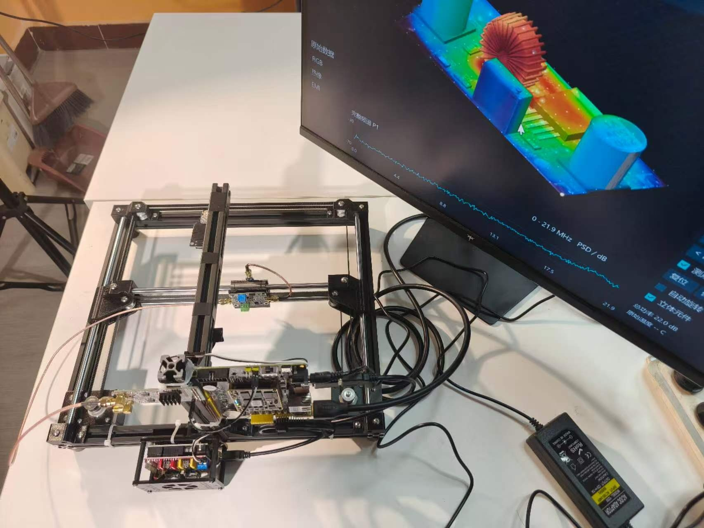
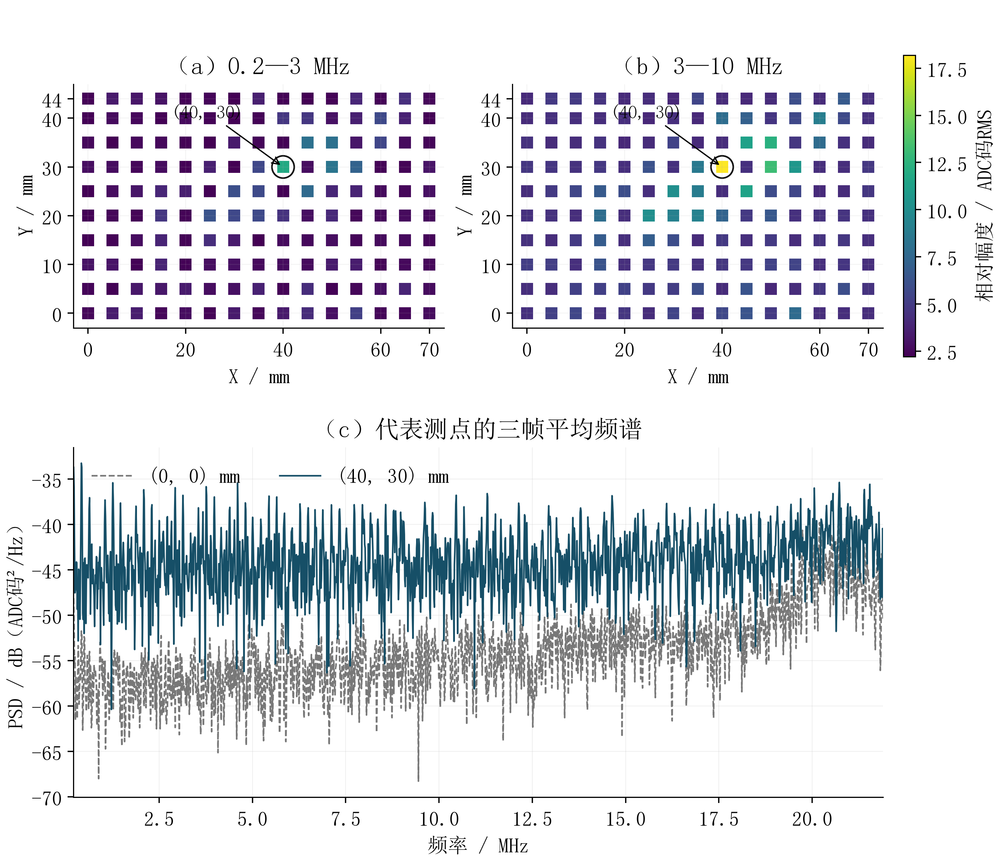

# 基于FPGA的桌面式PCB多模态检测系统

桌面式PCB检测原型，结合CoreXY近场扫描、RGB、红外热像和ADC波形，在Zynq平台上组织板卡位置、温度、频谱与交互显示。

**最终程序：PDP3-report2-audit-fixes-r6；对照分析报告已于11月4日更新。** [浏览源码](source/README_GITHUB.md) · [下载完整包](https://github.com/tongzeyu-crypto/fpga-pcb-multimodal-inspection/releases/tag/code-20261104-doc-update) · [对照分析报告](source/docs/修复核对.md) · [运行说明](source/docs/构建与运行.md)

## 最终版主要内容

- **PL处理链**：原始ADC标志/相位检查、双通道提取、4096点周期Hann FFT、三帧平均PSD与频段RMS；完整热像温度面、热点统计与伪彩色；共享图像算子与INT8网络。
- **PS处理与调度**：USB与机械接口、路线/停稳/三帧采样关联、几何映射、SIFT/RANSAC及规则判断、重投影和最终像素融合。
- **扫描与数据发布**：可配置范围、X/Y步距和1–120速度，最多1024点；完整扫描结果发布后由原有EMI、谱线、融合与立方体页面读取。
- **ADC双缓冲**：2×16384原始字乒乓RAM，所有权、ACK、背压、采集/读取重叠及逐帧序号和采样时钟戳。
- **两板与温度查询**：STM32和DC-DC独立RGB、热像、模型、标定及输入关联；原始热像点击、融合板面点击和最高温定位。
- **神经帧融合**：共享PL卷积核生成α_R权重，PS按α_R·R+(1−α_R)·P合成过渡帧，配套逐像素及保留视角检查。

程序按最终交付版本归档，当前展示文档采用提交方提供的对照分析报告。当前包记录源码集成、ARM编译、RTL、整机布局布线及电脑界面检查；具体运行配置和验证范围以[对照分析报告](source/docs/修复核对.md)与[验收记录](source/docs/验收记录.md)为准。电脑演示采用模拟运动、历史原始输入和已核验RTL结果回放；真实扫描入口显式选择 `--live-scan` 与实际运动配置。

## 架构与数据

PDP3接口为本版频谱、热像与共享算子提供统一任务入口；配准和帧融合复用INT8计算核。PS负责数据组织、运动管理及几何/规则流程，PL负责对应算术和图形显示。寄存器、单位及任务表见[处理链与接口](source/docs/处理链与接口.md)。

保留的DC-DC实测样例包括70×44 mm、150点、450帧原始ADC及原始机械坐标。当前完整包另收录两板RGB/热像和便携标定。频谱幅度采用相对ADC码²/Hz与RMS ADC码。

图为历史原始扫描的低/中频相对分布，代表点(40,30) mm。原始例子保留在 `examples/`，当前程序显示完整0–25 MHz频率轴；报告旧图21.9 MHz按历史材料解释。

## 材料导航

|材料|入口|
|---|---|
|最终程序源码、模型、配置|[source/](source/README_GITHUB.md)|
|完整代码包、位流、HDF、驱动|[最终版Release](https://github.com/tongzeyu-crypto/fpga-pcb-multimodal-inspection/releases/tag/code-20261104-doc-update)|
|逐项对照分析|[source/docs/修复核对.md](source/docs/修复核对.md)|
|当前版本及文件指纹|[source/VERSION.json](source/VERSION.json)|
|处理链、任务与寄存器|[处理链与接口](source/docs/处理链与接口.md)|
|启动与构建|[构建与运行](source/docs/构建与运行.md)|
|报告逐条实现对应|[报告实现对照](source/docs/报告实现对照.md)|
|功能与记录|[STATUS.md](STATUS.md) · [验收记录](source/docs/验收记录.md)|
|硬件实物和安装|[hardware/](hardware/README.md)|
|阶段技术报告|[PDF](reports/technical-report-20261030.pdf) · [Word](reports/technical-report-20261030.docx)|
|原始数据示例|[DCDC](examples/dcdc-scan/README.md) · [RGB/热像](examples/zynq-usb-capture/README.md)|
|来源与版权|[数据来源](docs/data-provenance.md) · [THIRD_PARTY.md](THIRD_PARTY.md)|

旧版程序、旧板端截图和阶段报告按各自日期保留；当前代码及对应说明以本页的最终版入口为准。
