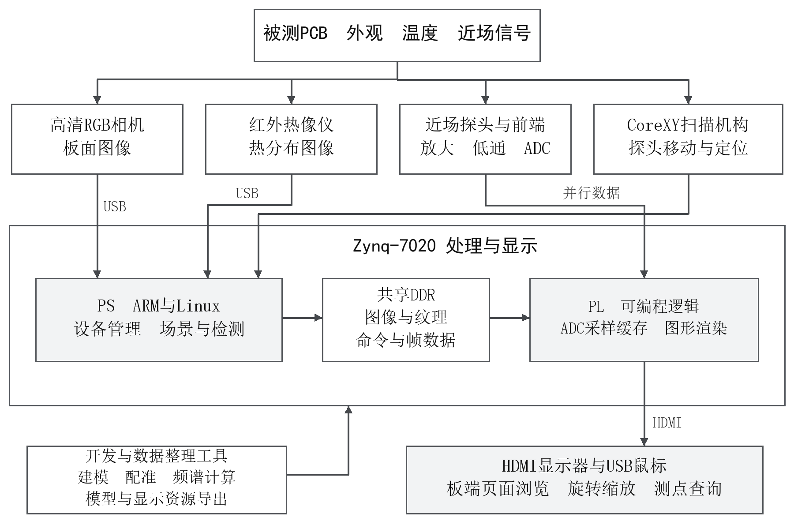
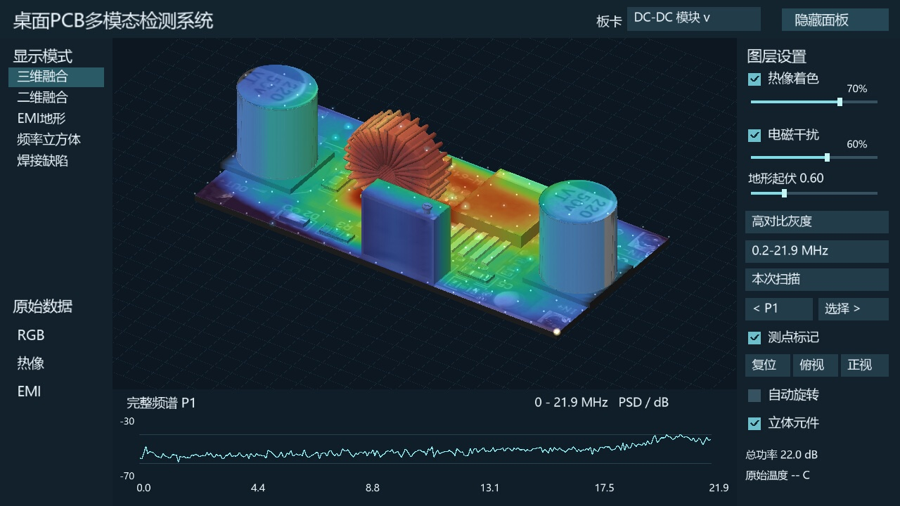

# 基于FPGA的桌面式PCB多模态检测系统

面向PCB研发调试与故障排查的桌面式原型系统：通过CoreXY机构移动近场探头，结合RGB、红外热像与ADC原始采样，在Zynq平台上关联板卡位置、温度与近场频谱，并由PL完成图形渲染和HDMI输出。

**完整源码整理中。** 本仓库首批公开实物、硬件说明、阶段报告、原始数据与板端展示材料；最终源码和完整定稿视频随后补入。材料整理日期：2026年11月3日。

## 已完成的主要部分

- 真实桌面机构与近场采集链：CoreXY、探头、放大/低通、AD9248与Zynq。
- DC-DC模块70×44 mm蛇形扫描，150个测点、450帧原始记录；提供原坐标、频谱汇总和代表点原始波形。
- 板端USB RGB与Tiny1-B热像采集样例，保留原始JPEG、双平面载荷与温度数组。
- PL图形渲染、独立HDMI与USB鼠标显示，2026年10月30日用户确认冷启动自动进入界面，支持两块板16个主要页面。

采集试验与独立显示验收属于不同阶段版本。AI配准、AI帧生成及统一实时链路的最终提交实现正在整理，具体范围见[功能状态](STATUS.md)。

## 系统结构

传感器与近场采样记录经处理形成板卡资源；PS组织数据和交互，PL完成图形绘制与HDMI显示。三维视图使用预建封装模型和照片纹理，参考RGB用于板面结构与外观对照。

## 代表结果

板端历史资源三维融合界面，热像含近似映射。界面展示坐标与原扫描坐标分别记录，原始实测数据以[examples/dcdc-scan](examples/dcdc-scan/README.md)为准。

DC-DC扫描的0.2–3 MHz和3–10 MHz相对分布，代表峰值点为(40,30) mm。幅度为相对ADC码，没有绝对场强或EMC合规结论。

## 材料导航

|材料|入口|
|---|---|
|功能与验证状态|[STATUS.md](STATUS.md)|
|系统架构、PS/PL与预建模型|[docs/architecture.md](docs/architecture.md)|
|数据来源与解释|[docs/data-provenance.md](docs/data-provenance.md)|
|现有操作与阶段验证|[docs/usage-and-validation.md](docs/usage-and-validation.md)|
|硬件模块、接口与安装|[hardware/](hardware/README.md)|
|12页技术报告|[PDF](reports/technical-report-20261030.pdf) · [Word](reports/technical-report-20261030.docx)|
|150点坐标、频谱与3点原始采样|[DCDC样例](examples/dcdc-scan/README.md)|
|板端RGB与热像原始数据|[USB采集样例](examples/zynq-usb-capture/README.md)|
|完整450帧数据包与演示片段|[首批材料Release](https://github.com/tongzeyu-crypto/fpga-pcb-multimodal-inspection/releases/tag/materials-20261103)|
|历史演示片段说明|[docs/video-materials.md](docs/video-materials.md)|
|照片与图表来源|[assets/](assets/README.md)|
|版权及第三方来源|[THIRD_PARTY.md](THIRD_PARTY.md)|

报告保留2026年10月30日的阶段版本。五处外观异常候选属于电脑直采照片的离线回归，STM32 EMI展示含模拟背景；这两项不作为本仓库板端实测例子。大数据包与视频放在Release，普通Git历史只保留可审阅材料和小规模原始样例。
