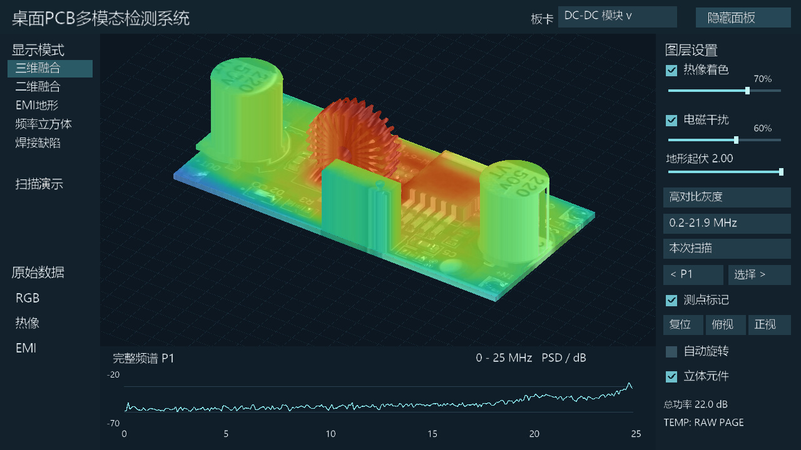
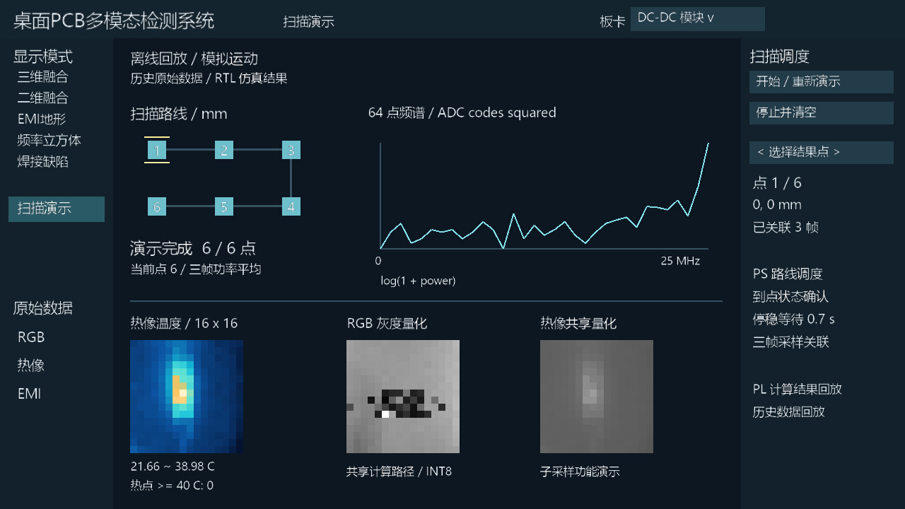

# 基于FPGA的桌面式PCB多模态检测系统

面向PCB研发调试与故障排查的桌面式原型系统：通过CoreXY机构移动近场探头，结合RGB、红外热像与ADC原始采样，在Zynq平台上关联板卡位置、温度与近场频谱，并由PL完成图形渲染和HDMI输出。

**2026年11月3日正式提交版代码已发布。** [浏览源码与模型权重](source/README_GITHUB.md) · [下载完整代码包](https://github.com/tongzeyu-crypto/fpga-pcb-multimodal-inspection/releases/tag/code-20261103-r2) · [运行与版本说明](docs/code-submission.md)。本次发布包含源码、模型、硬件产物与实板记录。

## 主要成果与当前版本

- 实物CoreXY、近场探头、放大/低通、AD9248与Zynq组成桌面扫描采集链。
- DC-DC模块70×44 mm蛇形扫描，150个测点、450帧原始记录，保留原坐标与完整频谱。
- 板端USB RGB与Tiny1-B热像原始样例，保留来源标记、JPEG、双平面载荷及温度数组。
- 11月3日提交包含配准与神经帧融合的训练/剪枝/INT8权重、共享PL计算核、图形渲染、ARM程序、驱动、构建工具及验证摘要。
- 随包实板记录确认RAM临时启动、两项PL推理与整数参考一致、HDMI完整显示及六点十八帧扫描回放；原自启动镜像保留。

扫描演示采用模拟运动、历史原始数据和已核验的独立算子结果回放；完整频谱/热像数值处理由PS执行，整机PL承载图形、共享CNN与ADC接口。具体见[功能状态](STATUS.md)和[实板记录](source/docs/实板演示记录-20261103.md)。

## 系统结构

采集记录按板卡与机械位置组织，PS承担调度、完整频谱/热像数值处理和重投影，PL承担图形绘制、HDMI及两项小模型推理。三维模型采用封装先验与照片纹理。图为10月30日总体结构，11月3日具体软硬件分工见[架构说明](docs/architecture.md)。

## 代表结果

来自正式代码包的实板记录。图形/AI/AXI核心配置62.5 MHz，1280×720源画面放大为1920×1080、30 Hz输出；该输出时序不是应用或AI的处理帧率。

板端调度器完成六点、十八帧历史数据关联及结果展示；运动为模拟，部分演示算子为经过核验的XSim结果回放。

历史DC-DC实测扫描的0.2–3 MHz和3–10 MHz相对分布，代表峰值为(40,30) mm。幅度为相对ADC码，没有绝对场强或EMC合规结论。

## 材料导航

|材料|入口|
|---|---|
|源码、模型与构建工具|[source/](source/README_GITHUB.md)|
|完整正式代码包、位流与驱动|[代码Release](https://github.com/tongzeyu-crypto/fpga-pcb-multimodal-inspection/releases/tag/code-20261103-r2)|
|电脑演示与复现说明|[docs/code-submission.md](docs/code-submission.md)|
|当前功能与验证状态|[STATUS.md](STATUS.md)|
|本版实板验证记录|[source/docs/实板演示记录-20261103.md](source/docs/实板演示记录-20261103.md)|
|系统架构与PS/PL分工|[docs/architecture.md](docs/architecture.md)|
|数据来源|[docs/data-provenance.md](docs/data-provenance.md)|
|硬件模块与安装|[hardware/](hardware/README.md)|
|10月30日阶段技术报告|[PDF](reports/technical-report-20261030.pdf) · [Word](reports/technical-report-20261030.docx)|
|150点频谱与3点原始采样|[DCDC样例](examples/dcdc-scan/README.md)|
|板端RGB与热像原始样例|[USB采集样例](examples/zynq-usb-capture/README.md)|
|首批数据与历史片段|[材料Release](https://github.com/tongzeyu-crypto/fpga-pcb-multimodal-inspection/releases/tag/materials-20261103)|
|材料目录|[docs/submission-follow-ups.md](docs/submission-follow-ups.md)|
|照片图表来源与版权|[assets/](assets/README.md) · [THIRD_PARTY.md](THIRD_PARTY.md)|

报告与早期截图保留其阶段日期。五处外观候选来自电脑直采的离线回归，STM32历史EMI含模拟背景；新提交版缺少STM32实采输入时保持等待，不把旧展示结果作为新测量。R2统一发布说明，算法、RTL、权重、执行程序和原始数据保持交付版本，完整包见Release。
