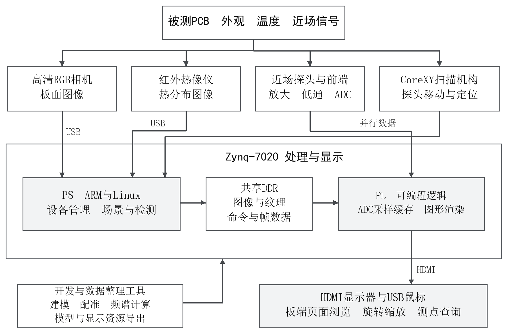
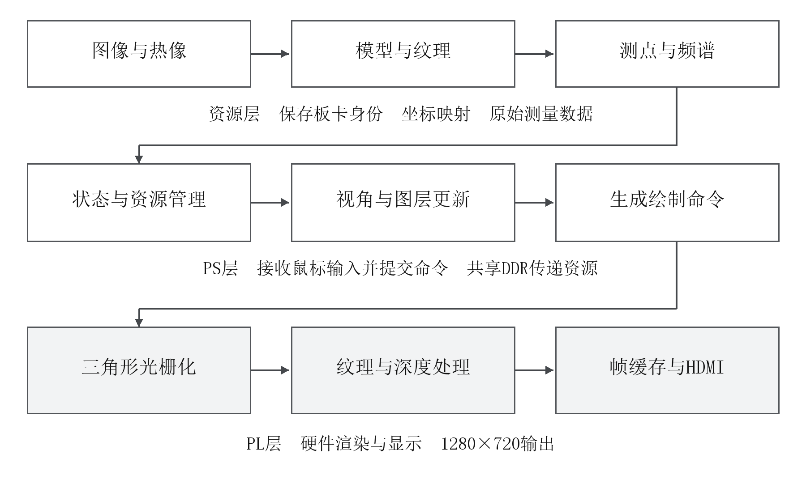

# 系统架构与PS PL分工

系统把板卡外观、温度分布和近场频谱关联到板面位置，包含传感采集、CoreXY逐点扫描、资源处理和独立显示四部分。

RGB与Tiny1-B热像通过USB采集；近场探头随滑块移动，经放大和低通送到ADC。采集记录按板卡、测点和时间组织，频谱工具由原始波形生成频谱矩阵。模型与正常参考图作为外部参考资源，处理结果进入Zynq显示路径。

|侧别|已稳定验证职责|提交版待核实部分|
|---|---|---|
|PS ARM|场景与资源组织、USB鼠标事件、板卡与页面切换、向PL提交绘制任务|统一传感调度、待测数据入口、AI结果衔接|
|PL|三角形光栅化、深度比较、纹理采样、图形缓存与HDMI输出；另一调试构建含ADC采样逻辑|两项AI加速、统一版本ADC处理及端到端闭环|
|开发与数据工具|封装模板、照片纹理、频谱后处理、历史图像分析和资源导出|完整可复现源码由最终提交版补齐|

预建三维模型采用封装模板、元件类别/轮廓/方向和照片纹理组合，不是从传感器直接恢复的精密三维测量。标准板参考用于外观对照与坐标关联。最终代码要求外部仅导入正常参考RGB与预建三维模型，待测RGB、热像及ADC来自Zynq或板端真实采集记录；这个目标与历史演示资源应分别阅读。
