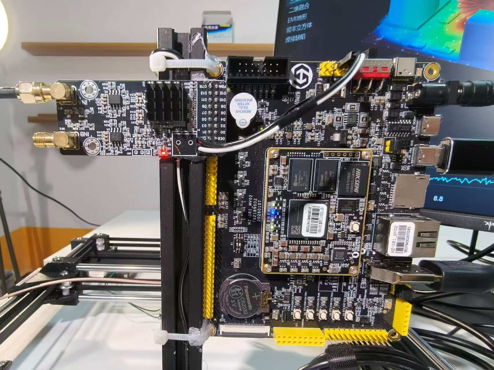
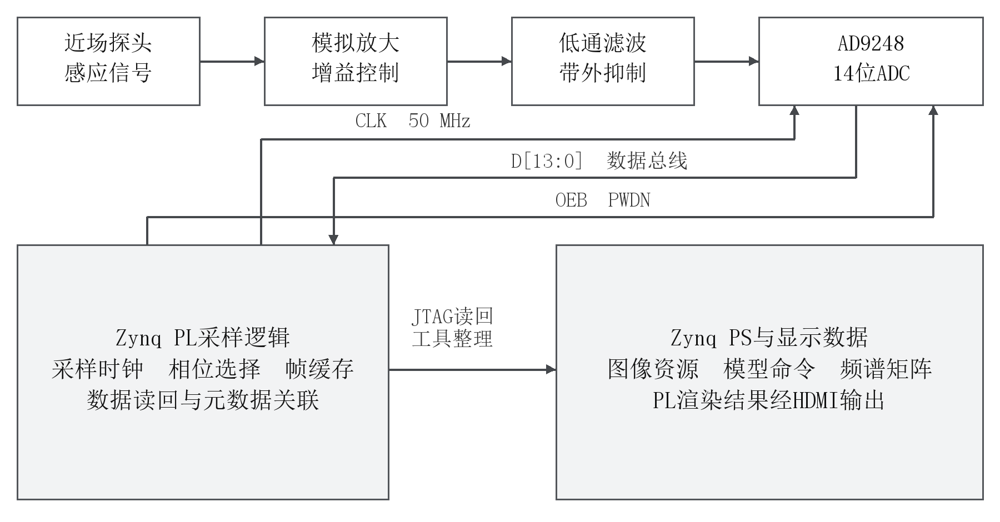
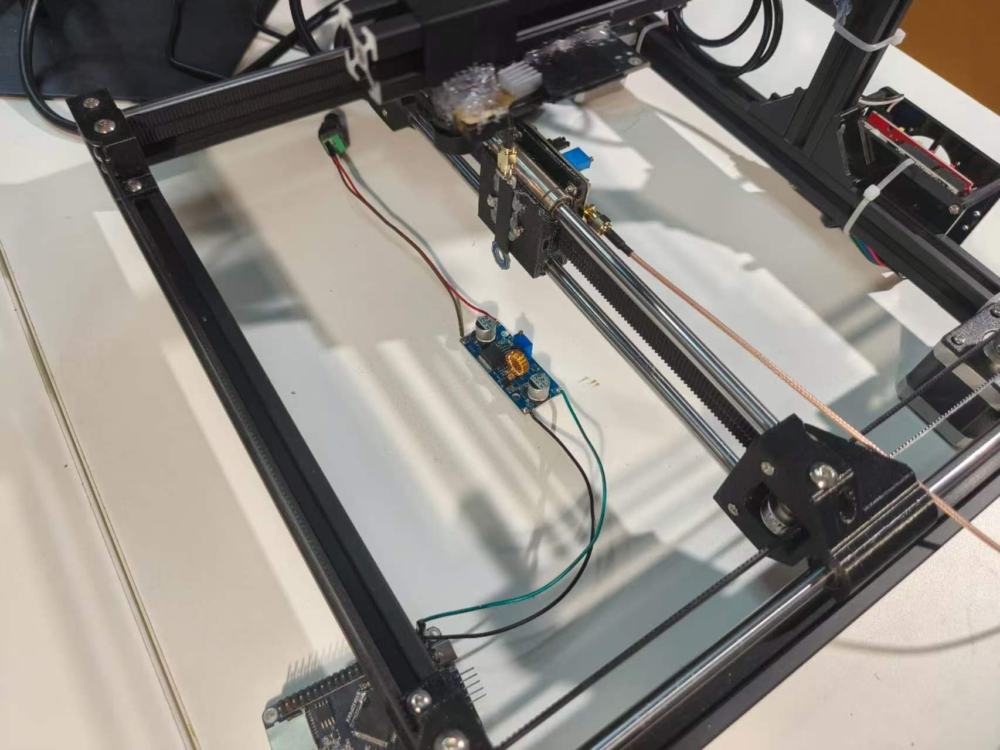
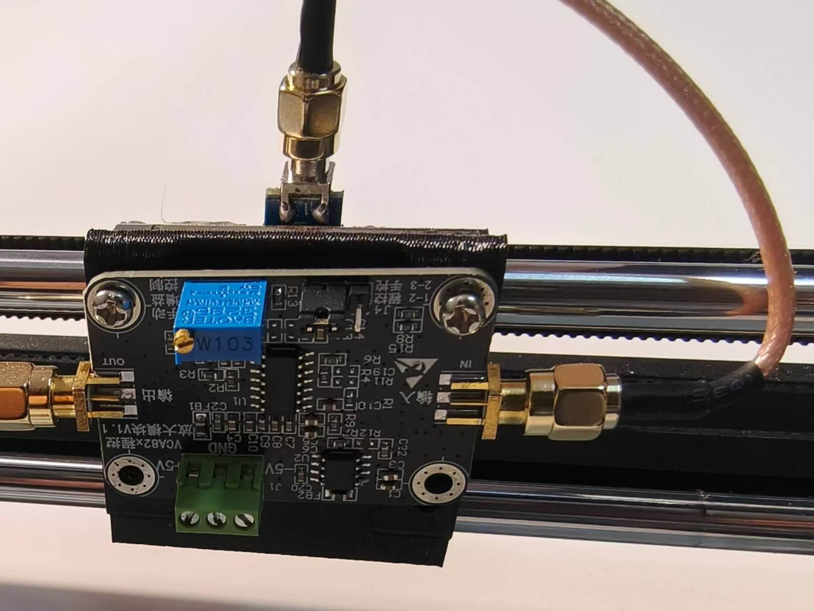

# 硬件与接口

|模块|证据与用途|型号说明|
|---|---|---|
|Zynq开发板|实物图及板端运行记录，PS/PL处理和HDMI|Zynq-7020平台，开发板为采购模块|
|ADC模块|实物与采样构建记录，并行数据采样|AD9248，双通道14位；本次标称50 MS/s配置|
|RGB相机|USB板端JPEG采集记录|通用USB身份，IMX577为选型记录，未核实实物传感器|
|热像仪|Tiny1-B双平面原始载荷|本批样例对应Tiny1-B，256×192图像/温度平面|
|近场探头与模拟前端|实拍探头、放大、低通与连接|来源为购买模块及项目集成；具体放大器/滤波器型号不以模糊照片推断|
|CoreXY与控制板|实拍框架、滑块、GRBL记录|采购套件与项目安装集成，未发布自制机械图纸|

接口链路为近场探头→有源放大→低通→ADC INA→PL采样缓存。ADC并行D[13:0]、CLK、OEB与PWDN由具体采样工程约束；本批材料用于说明连接关系，不作为可直接照接的完整引脚表。显示路径为PS资源/命令→共享DDR→PL绘制→HDMI；RGB/热像与鼠标通过USB接入相应软件路径。

探头固定于滑块支架，PCB保持固定；扫描前设置人工起点、探头姿态与高度，并检查运动范围内的线缆和结构间隙。当前记录没有自动回零、限位保护或校准定位精度的证明。5 mm是采样网格间距，末行4 mm，不能作为机械精度指标。

模块、套件与控制固件的第三方性质见[来源说明](../THIRD_PARTY.md)。没有虚构采购成本、定位精度或测量精度；最终接口约束、原理图与源码由完整工程确认后补入。
